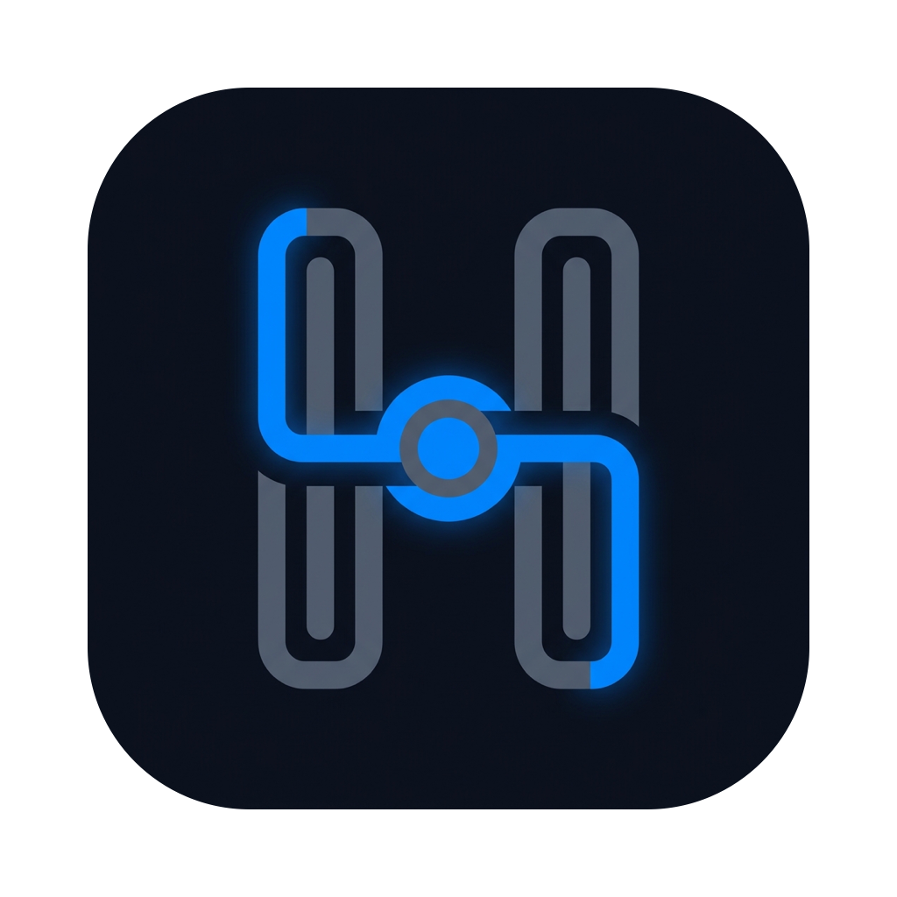
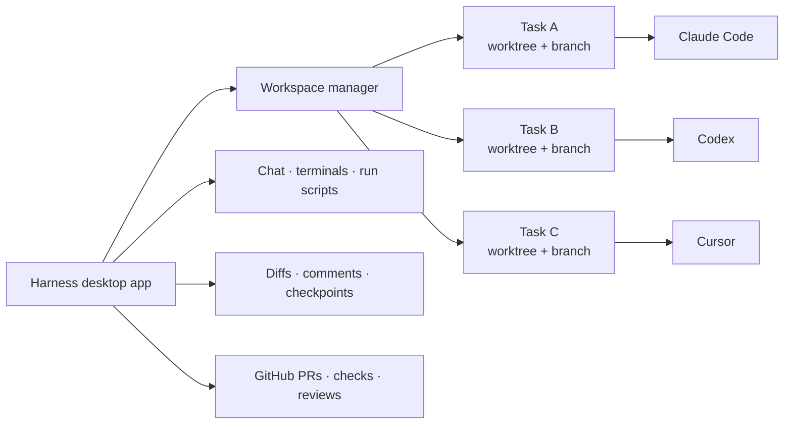

<p align="center">
  
</p>

<h1 align="center">Harness</h1>

<p align="center">
  <strong>Run coding agents in parallel. Keep every task isolated, observable, and reviewable.</strong>
</p>

<p align="center">
  Harness is a local-first desktop workspace for Claude Code, Codex, and Cursor.<br />
  Every task gets its own Git worktree, branch, chat, terminals, and review loop.
</p>

<p align="center">
  <a href="https://github.com/serolo/Harness/actions/workflows/ci.yml"></a>
  <a href="https://github.com/serolo/Harness/releases/latest"></a>
  <a href="#install"></a>
  <a href="https://www.electronjs.org/"></a>
  <a href="https://www.typescriptlang.org/"></a>
</p>

<p align="center">
  <a href="#install">Install</a> ·
  <a href="#what-you-can-do">Features</a> ·
  <a href="#development">Development</a> ·
  <a href="#architecture">Architecture</a>
</p>

## Why Harness?

Coding agents are most useful when they can work independently, but running several of them against
the same checkout creates conflicts and makes progress hard to follow. Harness turns one repository
into a set of focused workspaces:

- **One task, one worktree.** Every agent works on an isolated branch and filesystem checkout.
- **One place to supervise.** Follow streaming conversations, running processes, terminals, and task
  state without switching applications.
- **A built-in review loop.** Inspect diffs, leave line comments, send feedback to the agent, and
  checkpoint or restore work before it reaches a pull request.
- **Your tools and accounts.** Harness drives agent CLIs already installed on your machine; it does
  not introduce a separate model API or billing layer.

## What you can do

| Area | Capabilities |
| --- | --- |
| Parallel workspaces | Create, restore, reorder, and archive isolated Git worktrees with dedicated branches and ports. |
| Agent conversations | Stream turns from Claude Code and Codex, use Cursor through a terminal fallback, attach files, and keep durable chat history. |
| Custom agents | Compose coordinator and child-agent configurations from versioned YAML and Markdown skill bundles. |
| Terminals and processes | Open multiple PTY-backed terminals, run project scripts, inspect logs, and stop process trees cleanly. |
| Review | Browse changed files in a Monaco diff, filter by commit, add inline comments, send feedback to an agent, and create turn checkpoints. |
| Delivery | Commit and push changes, open pull requests, inspect checks and review threads, fix failures with an agent, and merge when ready. |
| Tasks and automation | Queue or schedule agent work with per-task model, effort, mode, and agent snapshots. |
| Project knowledge | Search local project knowledge, inject bounded context into turns, and review proposed knowledge updates. |

Harness also includes a command palette, configurable themes and notifications, usage views, layered
project settings, deep links, and signed in-app updates.

## How it works



The Electron main process owns Git, SQLite, child processes, PTYs, integrations, and durable state.
The sandboxed React renderer can reach those services only through a typed `contextBridge` API.

## Install

### macOS release

Download the latest signed and notarized build from
[GitHub Releases](https://github.com/serolo/Harness/releases/latest). Builds are published for Apple
silicon and Intel Macs running macOS 13 or newer.

Windows and Linux remain supported source-build targets, but their packaged release pipelines are
temporarily paused while cross-platform distribution is stabilized.

### Run from source

You will need:

- Node.js 22 or newer and npm
- Git
- [GitHub CLI](https://cli.github.com/) authenticated with `gh auth login`
- At least one authenticated agent CLI: Claude Code or Codex (Cursor is also available as a
  raw-terminal adapter)

```sh
git clone https://github.com/serolo/Harness.git
cd Harness
npm install
npm run dev
```

`npm install` rebuilds the native `better-sqlite3` and `node-pty` modules for Electron. If those
bindings need to be rebuilt later, run `npm run rebuild`.

> [!IMPORTANT]
> Agent commands and project run scripts execute with your user privileges inside their worktrees.
> Review project configuration and agent permissions before running code you do not trust.

## Development

| Command | Purpose |
| --- | --- |
| `npm run dev` | Start Electron and Vite in development mode. |
| `npm run build` | Build the main, preload, and renderer targets. |
| `npm run test` | Run Vitest through the Electron test harness. |
| `npm run test:e2e` | Run Playwright end-to-end tests against the built app. |
| `npm run check` | Type-check, lint, test, and build. |
| `npm run package` | Package the app for the current host OS. |
| `npm run migrate` | Run local SQLite migrations. |
| `npm run rebuild` | Rebuild native dependencies for Electron. |

The repository's complete local gate is:

```sh
bash ci/harness-gates.sh
```

Vitest files run under Electron. To run one focused test file:

```sh
node scripts/vitest-electron.mjs run path/to/file.test.ts
```

## Architecture

```text
src/main/      Electron main process: Git, DB, agents, PTYs, integrations, IPC
src/preload/   Hardened contextBridge API exposed to the renderer
src/shared/    Typed contracts shared across process boundaries
src/renderer/  React UI, feature views, stores, and IPC clients
resources/     Built-in agent and skill bundles
e2e/           Playwright Electron tests
scripts/       Migrations, release helpers, and test utilities
docs/          Product spec, implementation plans, privacy, and workflows
```

The most important design constraints are deliberate:

- The renderer stays sandboxed with context isolation enabled.
- `src/shared/**` is an append-only IPC and data contract.
- Every IPC handler crosses one normalized, typed error boundary.
- SQLite schema changes ship as migrations because app data lives on the user's disk.
- Agent prompts, repository data, and credentials never belong in renderer-accessible logs.

Start with the [product specification](docs/parallel-agents-spec.md), then read the
[implementation map](docs/implementation-plan/README.md) and
[developer workflow](docs/ai_harness/DEVELOPER_WORKFLOW.md). Repository-wide engineering rules live
in [AGENTS.md](AGENTS.md).

## Privacy and local data

Repositories, conversations, diffs, commands, terminal output, and app state are stored locally.
Anonymous product analytics and crash reporting are separate, optional, and disabled by default;
their payloads exclude prompts, code, paths, diffs, terminal output, and credentials. See the full
[privacy notes](docs/privacy.md).

## Release status

Harness is under active development. Production releases currently target macOS arm64 and x64;
Windows and Linux packaging remains in the repository for ongoing stabilization. See
[the release guide](docs/RELEASING.md) for the signed build and verification process.

---

<div align="center">
  Built for developers who want more agents working—and less work coordinating them.
</div>
